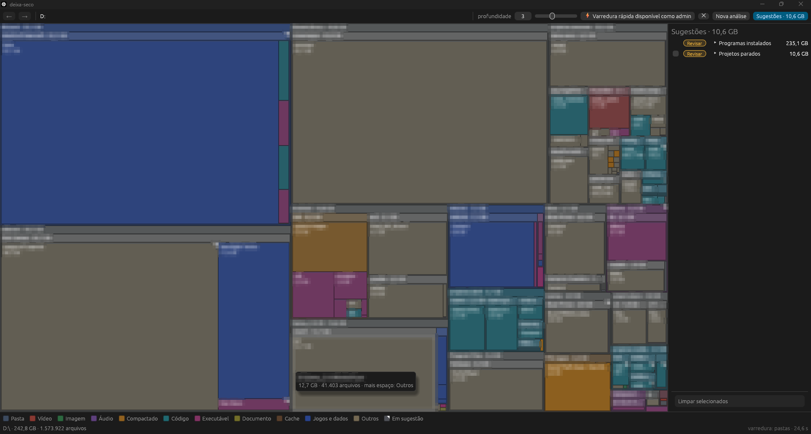
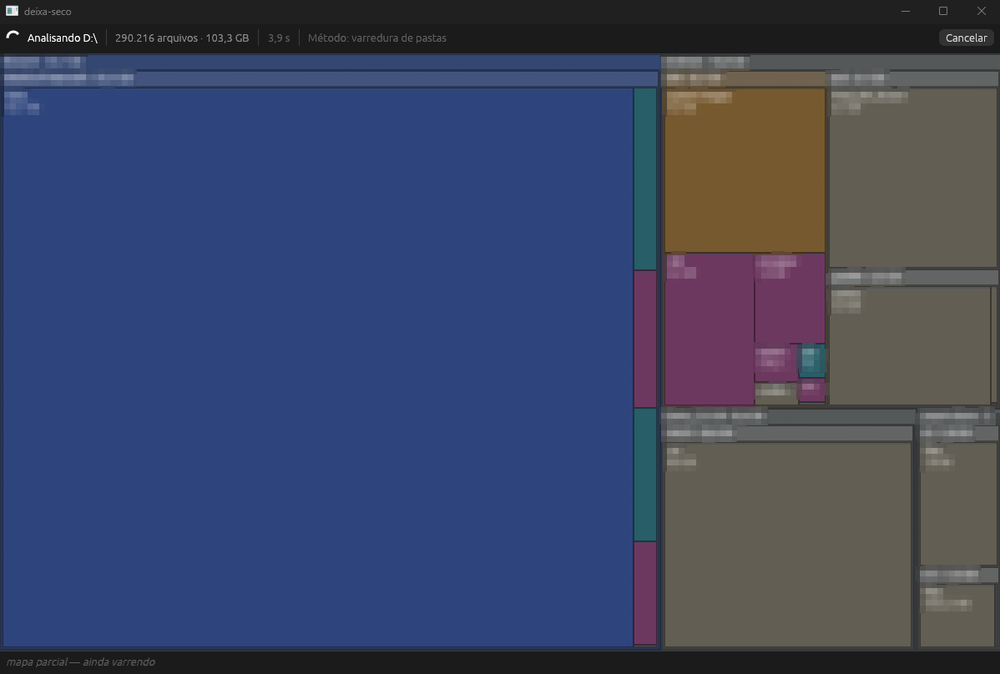
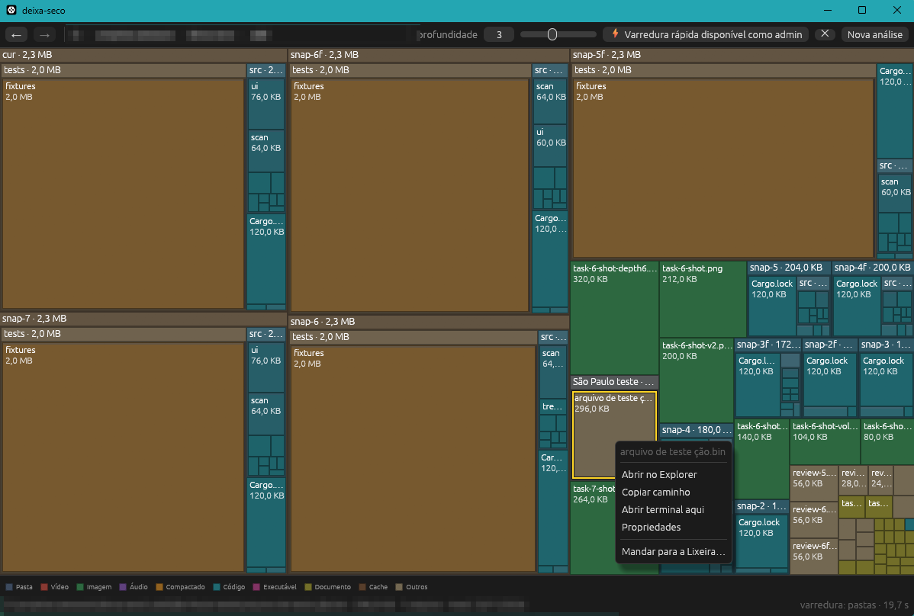
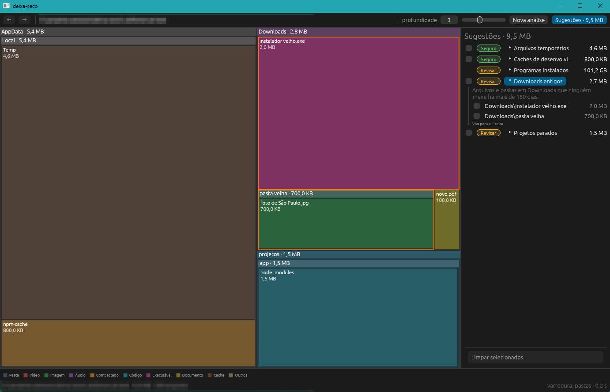
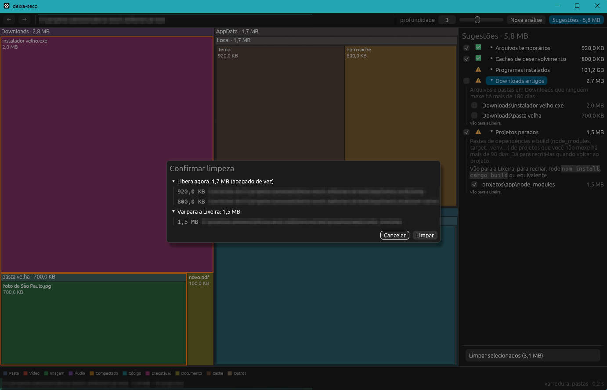
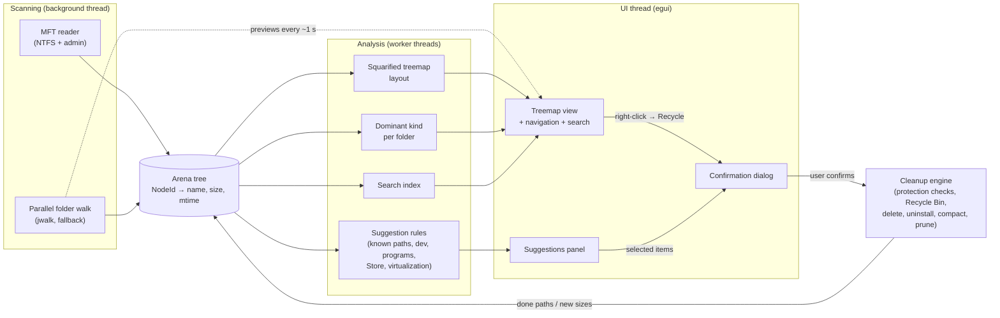
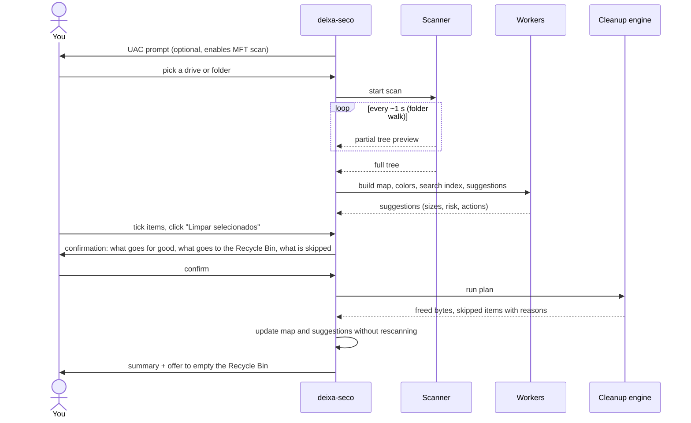
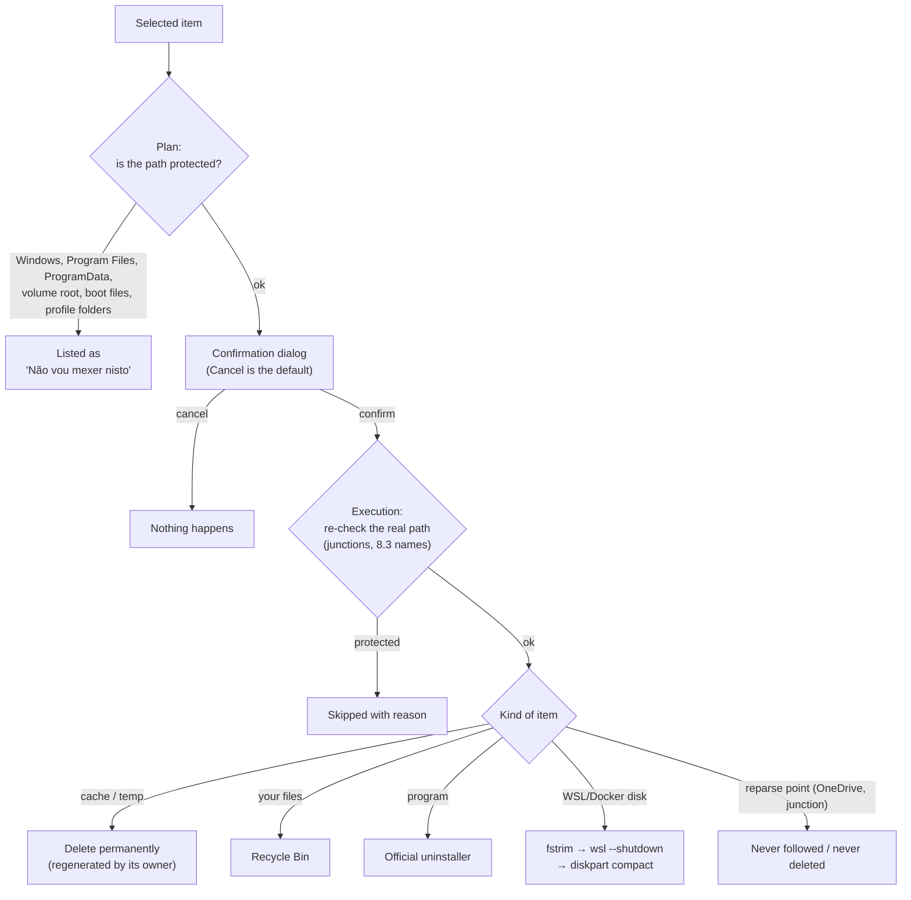

# deixa-seco

**A fast disk space analyzer for Windows that shows where your space went — and helps you get it back.**

`deixa-seco` (Brazilian Portuguese slang, roughly *"leave it dry"*) scans a drive, draws it as an interactive treemap, explains what is taking up space in plain categories, and runs the cleanup for you — always behind a confirmation dialog. It is written in Rust with [egui](https://github.com/emilk/egui) and ships as a single executable.

> The user interface is in Brazilian Portuguese.



*Folder names and paths in the screenshots are pixelated on purpose.*

## Features

- **Fast scanning.** With admin rights it reads the NTFS Master File Table directly; otherwise it falls back to a parallel folder walk. The map starts drawing while the scan is still running.
- **Treemap that tells you what is inside.** Each folder is colored by the kind of content that dominates it (video, images, code, games/data, caches…), with a legend. Sizes are the space actually **allocated on disk**, which is what you get back when you delete.
- **Easy navigation.** Double-click to zoom into a folder, clickable breadcrumb, back/forward (Backspace, mouse side buttons), adjustable depth, and `Ctrl+F` search that jumps to the result.
- **Right-click actions on any block.** Open in Explorer, copy path, open a terminal there, Windows properties, or send to the Recycle Bin.
- **Cleanup suggestions**, each with a risk level (*Seguro* = safe, *Revisar* = review, *Info* = informational):
  - temporary files, browser caches, Windows Update download cache, developer caches (npm, pip, cargo, gradle, NuGet);
  - `node_modules`, `target`, `build`/`dist`, `.venv` of projects untouched for 90+ days;
  - Downloads older than 180 days;
  - installed programs (registry and Microsoft Store), only those that live on the scanned drive, with their official uninstallers;
  - WSL and Docker virtual disks (compaction), unused Docker images and build cache, Android emulator snapshots, unused system images and idle emulators, and idle VM disks/ISOs;
  - Recycle Bin, `pagefile.sys`, `hiberfil.sys` (informational, with tips).
- **Safe by design.** Nothing runs without confirmation. Regenerable caches are deleted for good; anything you pick yourself goes to the Recycle Bin. System folders (`Windows`, `Program Files`, `ProgramData`, boot files) and OneDrive placeholders are never touched; junctions and symlinks are never followed.

| Live map while scanning | Right-click menu |
|---|---|
|  |  |

| Suggestions panel | Confirmation before anything runs |
|---|---|
|  |  |

## How it works

### Architecture



The UI thread never does heavy work: scans, analysis, the search index and every cleanup run on background threads and hand results back through channels.

### From launch to cleanup



### Safety layers



## Requirements

- Windows 10 or 11 (x64)
- [Rust](https://rustup.rs/) 1.85+ (edition 2024) to build
- Admin rights are optional: they enable the fast MFT scan and a few system cleanups (Windows Update cache, VHDX compaction)

## Build and run

```powershell
git clone https://github.com/barretoga/deixa-seco.git
cd deixa-seco
cargo build --release
.\target\release\deixa-seco.exe
```

The app asks for admin rights through UAC when it opens. Decline to run with the regular folder scan, or skip the prompt with:

```powershell
.\target\release\deixa-seco.exe --sem-admin
```

Start scanning a drive right away with `--scan C`.

## Tests

```powershell
cargo test
```

Tests never touch real user files: deletion tests run inside temporary folders, and commands that would stop WSL, run `diskpart`, prune Docker, empty the Recycle Bin or uninstall programs are only built and inspected, never executed.

Some tests need admin rights and are ignored by default. To compare the MFT scan against the folder walk on your C: drive (read-only), run in an elevated terminal:

```powershell
cargo test --release --test mft -- --ignored --nocapture
```

## Project layout

| Path | What it does |
|---|---|
| `src/scan/` | MFT reader, parallel folder walk, scan thread and live previews |
| `src/tree.rs` | Arena tree of files and folders (sizes, search, removal, resize) |
| `src/treemap.rs` | Squarified treemap layout |
| `src/kind.rs` | File kinds and per-folder dominant kind |
| `src/insights/` | Suggestion rules: known caches, dev artifacts, programs, Store apps, virtualization |
| `src/cleanup.rs` | Protection checks and execution of every cleanup action |
| `src/ui/` | egui screens: drive list, map, navigation, search, suggestions, confirmation |
| `docs/images/` | Screenshots used in this README (folder names and paths are pixelated) |

## Inspiration

The treemap idea is inspired by [SpaceSniffer](http://www.uderzo.it/main_products/space_sniffer/). deixa-seco is an independent implementation and shares no code or assets with it.

## License

[MIT](LICENSE)
